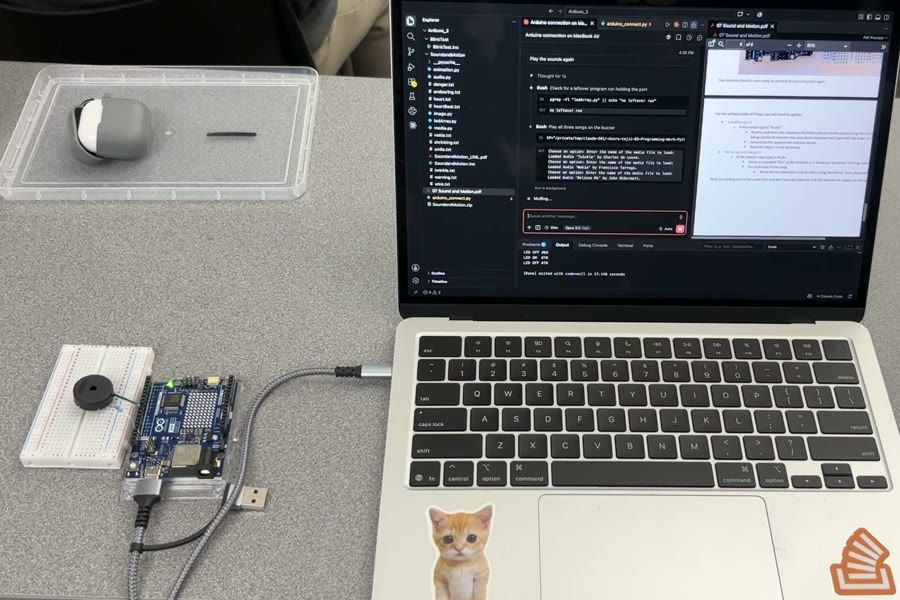
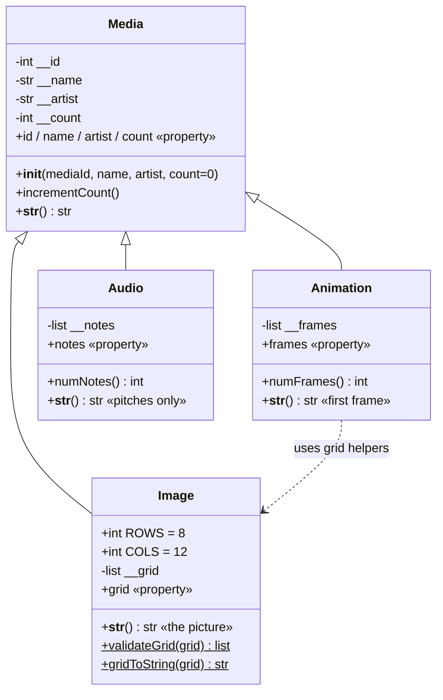

# Arduino Sound and Motion

A Python program that loads **images**, **animations** and **songs** from text files and plays them on an
**Arduino UNO R4 WiFi**: pictures and animations on the built-in 12×8 LED matrix, songs on a piezo buzzer.
The Python side and the Arduino talk over USB serial.

The main idea is **inheritance**. The three media types share a `Media` superclass that holds what they have
in common, and each subclass adds only its own data.

## Demo

[](Demo_Video.MOV)

▶️ Click the image to open [`Demo_Video.MOV`](Demo_Video.MOV) (8 s, sound on). It shows the program sending
the songs to the Arduino, which plays them on the buzzer wired through the breadboard.

## Features

- Load media from `.txt` files. The program reads the `type:` line first, then creates the right object.
- **Image:** shows a still 12×8 picture on the LED matrix.
- **Animation:** plays the frames on a loop (250 ms each) until something else is sent.
- **Audio:** plays a song note by note on the buzzer (pitch in Hz plus note length, with `0` as a rest).
- The menu previews every loaded item in the terminal. Images and animations are drawn as `#`/`.` grids
  (an animation shows its first frame), and songs are listed by their pitches.
- Counts how many times each item has been played, and saves your library between runs (`media.dat`).
- Checks every file as it is loaded. Bad grids or notes are rejected with a clear message, and the
  program keeps running.

## Hardware

| Part | Notes |
|---|---|
| Arduino UNO R4 WiFi | Its built-in LED matrix is used for images and animations |
| Breadboard | |
| Piezoelectric buzzer | |
| 220 Ω resistor | |
| Jumper wire | |
| USB-C cable | |

**Wiring:** do this with the board unplugged.

```
Arduino pin 8 ──jumper──► breadboard row 20 ──► buzzer leg
Arduino GND  ──220 Ω───► breadboard row 16 ──► buzzer leg
```

Push the buzzer's two legs into rows 16 and 20, on the opposite side of the breadboard's centre gap from the
jumper and resistor, and press it all the way in.

## Class design



- **`Media`** ([media.py](SoundandMotion/media.py)) holds the fields every type shares: id, name, artist and
  play count.
- **`Image`**, **`Animation`** and **`Audio`** each add only their own data, call `super().__init__()` first,
  and override `__str__()`.
- The media type isn't stored as a field. The program checks the object's class with `isinstance()` instead.
- All fields are private and go through validating `@property` setters. The getters return copies, so data
  can't be changed from outside by accident.

The full diagram (attributes, methods, visibility and notes) is in
[`SoundandMotion_UML.pdf`](SoundandMotion/SoundandMotion_UML.pdf).

## Repository layout

```
.
├── README.md
├── Demo_Video.MOV
├── docs/demo_thumbnail.jpg
└── SoundandMotion/
    ├── SoundandMotion.ino      # Arduino sketch: receives media over serial, drives the matrix and buzzer
    ├── ledArray.py             # Main program: menu, file loading, sending to the Arduino
    ├── media.py                # Media superclass
    ├── image.py                # Image(Media)
    ├── animation.py            # Animation(Media)
    ├── audio.py                # Audio(Media)
    ├── SoundandMotion_UML.pdf  # UML class diagram
    └── *.txt                   # Sample media files
```

## Media file format

Every file starts with the same three header lines (the shared `Media` data). What follows depends on the type.

<table>
<tr><th>Image</th><th>Animation</th><th>Audio</th></tr>
<tr valign="top"><td>

```
type:Image
name:Heart
artist:Milburn Issoufou
0,0,1,1,0,0,0,1,1,0,0,0
0,1,0,0,1,0,1,0,0,1,0,0
...  8 rows × 12 values
```

</td><td>

```
type:Animation
name:Wink
artist:Ville Valentino
0,0,0,0,0,0,0,0,0,0,0,0
...  8 rows (frame 1)

0,0,0,0,0,0,0,0,0,0,0,0
...  8 rows (frame 2)
```

</td><td>

```
type:Audio
name:Twinkle
artist:Charles de Lusse
262,4
262,4
392,4
...  pitch,duration
```

</td></tr>
</table>

- **Image / Animation:** `1` turns an LED on and `0` turns it off. Animation frames are separated by a blank line.
- **Audio:** each line is `pitch,duration`. The pitch is in Hz, and `0` is a rest. The duration is a note
  fraction: `4` is a quarter note (250 ms), `8` an eighth and `1` a whole note.

| Image | Animation | Audio |
|---|---|---|
| `danger.txt`, `heart.txt`, `heartBeat.txt`, `smile.txt` | `shrinking.txt`, `warning.txt`, `wink.txt` | `twinkle.txt`, `nokia.txt`, `endearing.txt` |

## Serial protocol

The connection runs at 9600 baud. Every message starts with a type flag on its own line, then the payload.

| Type | What Python sends |
|---|---|
| Image | `1\n` then one frame line, `0xHHHHHHHH,0xHHHHHHHH,0xHHHHHHHH\n` |
| Animation | `2\n`, then the number of frames (for example `12\n`), then one frame line per frame |
| Audio | `3\n` then one `pitch,duration\n` line per note, in order |

A frame line holds all 96 LEDs (8 rows × 12 columns, row by row) packed into three 32-bit hex numbers, built
by `grid_to_hexLine()`.

## Getting started

**Requirements:** Python 3.8+, [pyserial](https://pypi.org/project/pyserial/), and either the
[Arduino IDE](https://www.arduino.cc/en/software) or [arduino-cli](https://arduino.github.io/arduino-cli/).

### 1. Upload the sketch

With arduino-cli:

```bash
arduino-cli core install arduino:renesas_uno
arduino-cli board list                      # find your board's port
arduino-cli compile -b arduino:renesas_uno:unor4wifi SoundandMotion
arduino-cli upload  -b arduino:renesas_uno:unor4wifi -p <your-port> SoundandMotion
```

Or open `SoundandMotion/SoundandMotion.ino` in the Arduino IDE, select **Arduino UNO R4 WiFi** and click Upload.

### 2. Set your serial port

Edit `main()` in [`ledArray.py`](SoundandMotion/ledArray.py) and use your board's port:

| OS | Example port |
|---|---|
| macOS | `/dev/cu.usbmodemXXXXXXXXXXXX` |
| Linux | `/dev/ttyACM0` |
| Windows | `COM3` |

### 3. Run it

Run it from inside the `SoundandMotion` folder, so the `.txt` files are found by name:

```bash
pip install pyserial
cd SoundandMotion
python3 ledArray.py
```

```
Welcome to the Arduino LED Matrix Media Manager!

1) Load media
2) Display media
3) Quit
Choose an option: 1
Enter the name of the media file to load: nokia.txt
Loaded Audio 'Nokia' by Francisco Tarrega.

Choose an option: 2

ID: 1  Name: Nokia  (Audio)
Artist: Francisco Tarrega
Times displayed: 0
659, 587, 370, 415, 554, 494, 294, 330, 494, 440, 277, 330, 440

Enter the ID of the media to display: 1        ← the buzzer plays the tune
```

## Notes

- An animation keeps looping on the board until the next item is sent, even after the program quits.
- The LED matrix is cleared while a song plays.
- Names must be unique. `heart.txt` and `heartBeat.txt` are both named "Heart", so whichever loads second is
  skipped.
- Your loaded library is saved to `media.dat` when you quit, and loaded again next time.
